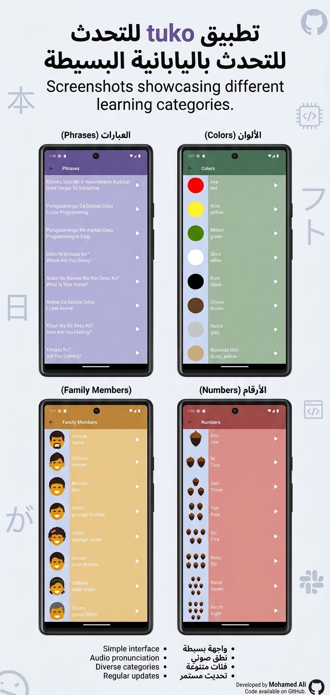

# 🇯🇵 Toku App

A simple Flutter application designed to help beginners learn Japanese words through audio pronunciation and easy-to-use categories.

## 📱 About The Project

Toku is a beginner-friendly language learning app that helps users explore Japanese vocabulary, learn its meaning in English, and listen to the correct pronunciation.

## ✨ Features

- 📚 Browse Japanese words organized into categories.
- 🔢 Learn Japanese numbers.
- 👨‍👩‍👧‍👦 Explore family member vocabulary.
- 🎨 Learn colors in Japanese.
- 💬 Practice useful Japanese phrases.
- 🔊 Listen to audio pronunciations.
- 🌙 Simple and user-friendly interface.

## 📸 Screenshots



## 🛠️ Technologies Used

- Flutter
- Dart

## 🚀 Getting Started

### Prerequisites

- Flutter SDK
- Dart SDK
- Android Studio or Visual Studio Code

### Installation

1. Clone the repository:

   ```bash
   git clone https://github.com/MohamedAliRizk-11/toku_app.git
   ```

2. Navigate to the project directory:

   ```bash
   cd toku_app
   ```

3. Install dependencies:

   ```bash
   flutter pub get
   ```

4. Run the application:

   ```bash
   flutter run
   ```

## 👨‍💻 Author

**Mohamed Ali**

- GitHub: [MohamedAliRizk-11](https://github.com/MohamedAliRizk-11)
- LinkedIn: [Mohamed Ali](https://www.linkedin.com/in/mohamed-ali-b56a23372/)

---

*Built with Flutter 💙*
